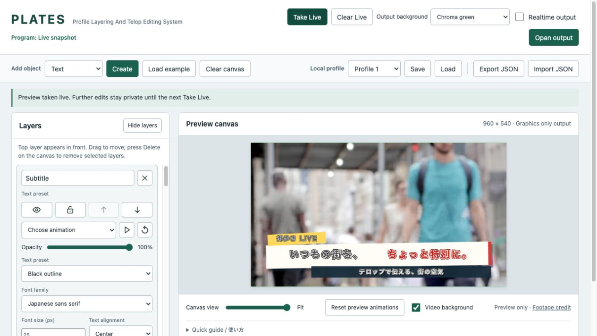

# PLATES

PLATES (Profile Layering And Telop Editing System) is a browser-based editor for live-stream graphics and captions.

**[Try PLATES live](https://thikeyeman.github.io/PLATES/)**



## Why I built it

PLATES started as a digital scoreboard I built for school events streamed on YouTube during COVID, so students who couldn't attend could follow along.

For my graduation project in 2022–2023, I expanded the idea into a telop editor with three classmates who worked on the graphics, design, and livestream setup, while I handled the programming. The current version is my own continuation of that project.

## Features

- Text captions with Japanese support, font choices, and 12 style presets
- Rectangles, image uploads, and controls for layer order, visibility, locking, and opacity
- Animations and a separate output window with chroma green or transparent output
- Preview/Program controls to keep edits separate from live graphics
- Local profiles and JSON import/export

## How it works

Fabric.js handles selecting, moving, resizing, rotating, and stacking objects on the canvas. Each text preset combines three textboxes for its lettering, outlines, and shadows. The layer controls edit these same objects.

**Preview** is the editable scene; **Program** is what goes to output. **Take Live** makes a separate copy of Preview, so later edits stay private until the next Take Live. Animations playing when you take a scene live can continue independently in Program. **Clear Live** clears Program without deleting Preview.

The editor copies Program's rendered pixels directly into a canvas in the output window, without selection handles or a server connection. The city video is a separate element behind Preview and never enters saved scenes or output.

## Design decisions

- **Local browser storage.** Profiles use `localStorage`, with no account or backend. Saves stay in the current browser and site address rather than syncing between devices.
- **JSON backups.** A file keeps the Preview scene, layer settings, and embedded images together. Images make it portable but increase file size. Imports are checked and reconstructed before replacing the current scene.
- **Optional realtime output.** Take Live keeps draft edits off air. Realtime output follows Preview edits immediately; switching it off freezes Program, including animations.
- **Plain JavaScript.** HTML loads Fabric.js and the tool scripts directly, with no framework or build step. Shared canvas state and event handlers connect the controls, so script loading order matters.

## Run locally

With Python 3 installed, run this from the project folder:

```sh
python3 -m http.server 8765 --bind 127.0.0.1
```

Open [localhost:8765](http://localhost:8765). Edit the starter scene or use **Clear canvas** to start fresh. **Load example** restores it.

Use **Open output**, then **Take Live** to display your graphics for capture. Output defaults to **Chroma green**; **Transparent (alpha)** preserves the canvas's transparency. OBS is optional. There is no build step or package installation.

## Limitations

- Output is fixed at 960 × 540. Fonts use local fallbacks, so text can look different on another device.
- Browser storage can be cleared or fill up. Save profiles explicitly and export JSON for a portable backup.
- Projects are limited to 10 MiB and 200 objects. Images must be embedded raster images; external image URLs and SVG uploads are not supported.
- Output needs popup permission and stays tied to the editor window. Closing the editor closes output too. Transparency in a capture depends on the capture method.

## Third-party notices

[THIRD_PARTY_NOTICES.md](THIRD_PARTY_NOTICES.md) lists Fabric.js, its bundled components, and the CC0 city preview footage. No font files are bundled. No project-wide license has been assigned to the original application code.
